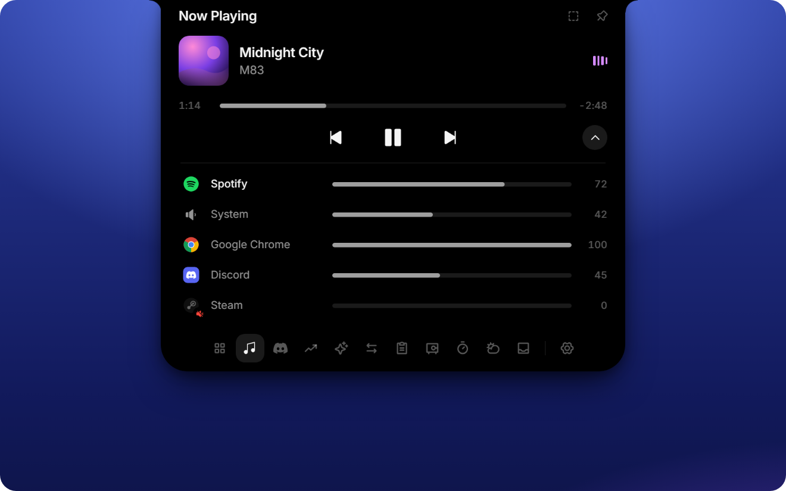
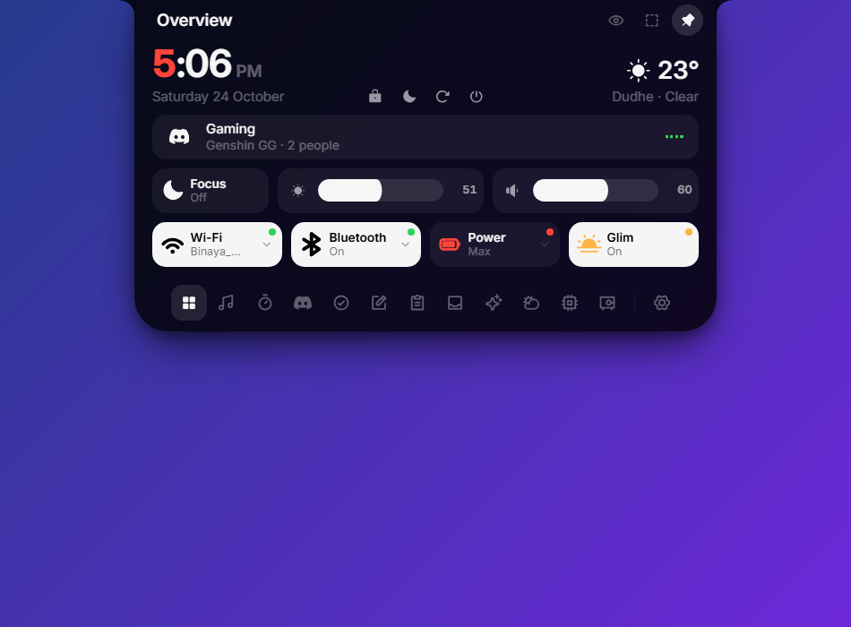
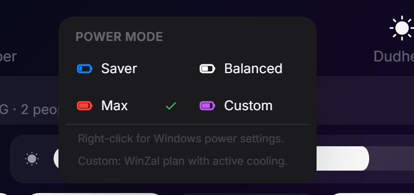
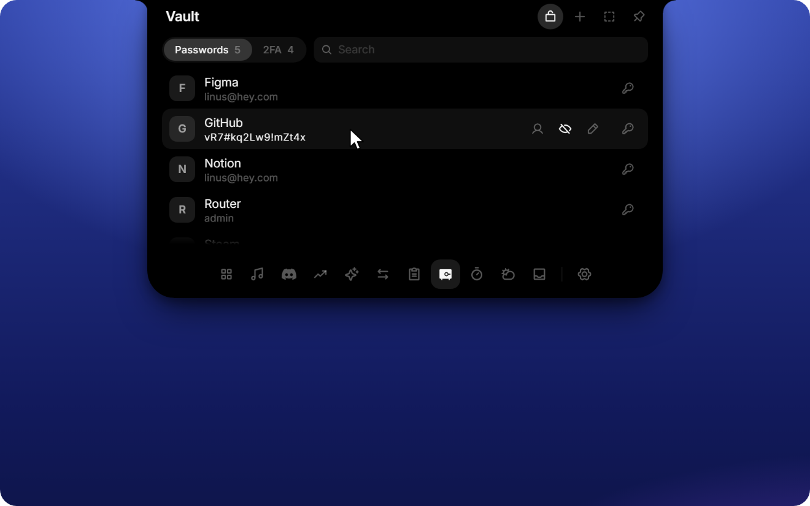
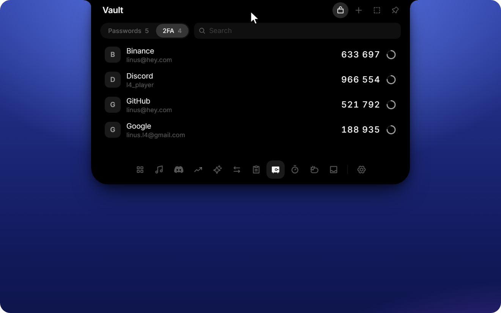
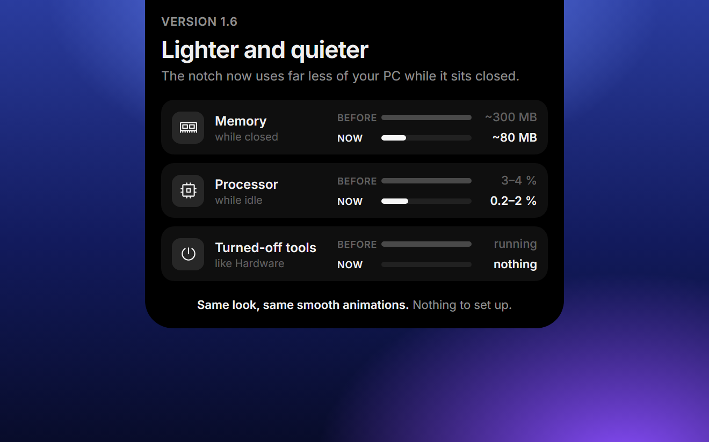

<p align="center">
  
</p>

<h1 align="center">WinZal</h1>

<p align="center">
  <b>A Dynamic Island for Windows.</b><br />
  Music, synced lyrics, gaming stats, Discord and power controls in one tiny notch at the top of your screen.
</p>

<p align="center">
  <a href="https://github.com/Bipin223/WinZal/releases/latest"></a>
  
  <a href="LICENSE"></a>
</p>

<p align="center">
  <a href="https://github.com/Bipin223/WinZal/releases/latest"><b>Download</b></a>
  &nbsp;·&nbsp;
  <a href="#features"><b>Features</b></a>
  &nbsp;·&nbsp;
  <a href="#install"><b>Install</b></a>
  &nbsp;·&nbsp;
  <a href="https://github.com/Bipin223/WinZal/issues/new"><b>Suggest an idea</b></a>
</p>

<p align="center">
  
</p>

WinZal turns the top edge of Windows into a Dynamic Island. It sits out of the way as a small black pill, opens when you hover, click or press **Ctrl + Alt + Space**, and morphs into a compact control center. The window itself never resizes — only the shape inside it moves — so the animations stay smooth and the app stays light.

It is a native **Windows 10 / 11 x64** app built with Tauri and WebView2. No Electron, no bundled Chromium, no account and no background analytics. Android is not part of this repository anymore; WinZal is Windows-only.

## Features

### The closed island

- **Large clock by default**, with a separately selectable **Compact** clock. The first digit uses a red accent by default.
- The expanded clock is **bold by default** and can be switched to Regular in Appearance.
- **Live music**: cover, title and a real audio-driven equalizer in the closed pill. The first app that starts playing keeps the pill; if it pauses or stops, the next playing app takes over automatically.
- **Synced lyrics** from LRCLIB, optional. One line or current + next line, **Default** or **Large**, and **Current / Apple / Word-by-word** animations. The pill grows to fit the line (up to 320 px) instead of fading readable text; extremely long lines scroll slowly.
- **Privacy dots** for microphone and camera (green) and screen recording (red), plus a recording badge.
- **Gaming + music**: when the FPS pill is visible and music is playing, the equalizer moves into its own **circular satellite island** to the left of the FPS pill. It works in both the Dynamic and Windows island styles.
- **Focus mode**: triple-click the notch to dim it or turn it into a thin line at the screen edge.

### Music and media

- Works with anything Windows exposes as a media session: **LI Music, Spotify, VLC, browsers** and other players.
- Click the **album cover** in the closed pill or in Now Playing to bring the actual playing app to the front.
- **Per-app volume mixer**, like the Windows mixer: Spotify, Chrome, Discord, games and the system volume in one place.
- Cover changes, progress and the equalizer follow the real playback state, not a timer.
- Play, pause, previous, next and seek from the notch, or open the full Now Playing view.

### Gaming

- FPS, CPU, GPU and RAM in the closed notch. Choose **Off**, **Games** or **Always**, and pick the games/apps that should trigger the overlay.
- A separate circular equalizer satellite appears next to the FPS pill when music is playing.
- FPS comes from a real ETW trace. Windows only allows that for administrators, so WinZal starts a tiny elevated helper with **one UAC prompt per run**. The app itself stays non-admin.
- CPU/GPU temperatures come from Lenovo's GameZone sensors through the same helper when available.

### Power modes

- **Saver**, **Balanced**, **Max** and a purple **Custom** mode in the Overview power tile.
- On AC power all four are available; on battery only **Saver** and **Balanced** are shown.
- **Max** is the former High mode. **Custom** is a WinZal power plan: a Balanced base with processor throttling open, 100 % maximum processor state and active cooling. It does not overwrite Lenovo Vantage's fan curve.
- Lenovo fan modes are kept in sync when the elevated helper is running.
- Right-click the tile for Windows power settings.

### Discord

- Current voice call with the channel, server and speaking members.
- Mute, deafen and hang up from the notch.
- **Rich Presence** with your own app name, an optional “Shown after Listening to” line (**Song / Artist / App name**) and two buttons: **Listen on YouTube Music** and **Get WinZal**.
- Uses the Discord desktop app and your own Discord developer application. Setup is under **Settings → Connections → Discord**.

### Everything else

- **Overview**: time, date, weather, now playing, Windows Focus (Do Not Disturb), volume, power mode, Wi-Fi/Bluetooth and the Glim night-light switch.
- **Clipboard** history for text, links, images and files, with previews and filters. Password managers are excluded and history stays in memory.
- **Shelf** for parking files: drop them on the notch or paste, then open, copy or reveal them later.
- **Vault** with passwords and live 2FA codes, a 4-digit PIN, optional **Windows Hello**, DPAPI + TPM-backed encryption and no back door.
- **Timer** with focus/break presets, six alarm sounds and a running countdown in the closed notch.
- **To-dos** and **Notes**, stored locally.
- **Ask**: chat with Gemini, Groq or any OpenAI-compatible endpoint. API keys stay in the backend.
- **AI usage**: limits for Claude, ChatGPT, Gemini and Cursor from the CLIs you are already signed in to.
- **Weather** through Open-Meteo, with a city picker and automatic IP-based location.
- **Hardware**: live CPU, RAM, GPU, VRAM and ping, with history while the notch is closed.
- **Presentation mode** hides clipboard, balances and vault while you share your screen.
- Autostart, tray menu, monitor picker, hide-in-fullscreen and drag-to-move.

## Screenshots

<p align="center">
  
  
</p>

<p align="center">
  
</p>

<p align="center">
  
  
</p>

<p align="center">
  
</p>

## Install

1. Download **WinZal_1.6.1_x64-setup.exe** from the [latest release](https://github.com/Bipin223/WinZal/releases/latest).
2. Run it. It installs for your user only; Node, Rust or administrator rights are not needed.
3. WinZal starts with Windows. The notch appears at the top of the screen and the tray icon keeps it reachable.

Windows 10/11 x64 and the WebView2 runtime are required. The installer fetches WebView2 automatically if it is missing.

The installer is not code-signed, so Windows SmartScreen may warn on first launch. Choose **More info → Run anyway** only if you trust the build.

### Updates

WinZal **1.6.1 and newer** check a signed `latest.json` from GitHub shortly after startup and once a day. Nothing downloads until you click **Install** under **Settings → Updates**.

If you are on **1.6.0 or older**, the old update endpoint no longer exists. Install **1.6.1 manually once**; after that, future signed updates can arrive through the app. Settings and local data are preserved because the app ID stays the same.

## Using WinZal

| Action | How |
| --- | --- |
| Open or close | Hover, click, or press **Ctrl + Alt + Space** |
| Switch tools | Tool bar at the bottom of the open notch |
| Settings | Gear at the end of the tool bar, or the tray menu |
| Tray | Left click opens the notch; right click for open, settings, autostart and quit |
| Move | Drag the notch sideways, closed or by its header |
| Focus mode | Triple-click the notch; triple-click again to leave |
| Add files | Drag files onto the notch, or paste with **Ctrl + V** |
| Power mode | Click the battery tile in Overview, or right-click it for Windows settings |
| Lyrics | **Settings → Music** for layout, size and animation |

## Settings and integrations

Settings are grouped into General, Display, Tools, Timer, AI, Connections, Music and Updates. You can reorder or hide tools, choose the monitor, hide the notch in fullscreen apps, enable autostart and switch the language.

**Discord.** Create an application at [discord.com/developers](https://discord.com/developers), copy its **Client ID** and **Client Secret** into **Connections → Discord**, add `http://localhost` as an OAuth2 redirect, then join a call. Discord asks for confirmation once.

**Ask.** Choose Gemini or Groq and paste your API key, or enter an OpenAI-compatible base URL and model. Keys are stored in Windows Credential Manager and never sent back to the interface.

**AI usage.** Nothing to enter. WinZal reads the existing local logins of Claude Code, Codex, Gemini CLI and Cursor.

**Weather.** Works out of the box with an approximate city from your IP. Pick a city manually in the weather tool to stop the lookup.

**FPS and temperatures.** Open **Settings → Display → FPS & CPU temperature** and approve the one UAC prompt. The helper stops with WinZal, so the prompt is needed again on the next run.

**Updates.** Automatic checks can be switched off under **Settings → Updates**. Manual **Check** and **Install** live there too.

## Privacy

WinZal has no account, no server of its own, no analytics and no tracking.

- Settings, to-dos, notes and timer presets live on your PC. Clipboard history is memory-only.
- API keys are kept in Windows Credential Manager, never in a plain settings file.
- The vault is encrypted with Windows DPAPI and bound to your Windows account. With Windows Hello, secrets are additionally sealed with a TPM-backed key. Forgot the PIN? Reset the vault; there is no recovery back door.
- Integrations talk directly to the service you configured: Discord to your local desktop app and discord.com, AI to your provider, weather to Open-Meteo. Unconfigured integrations make no requests.
- The update check fetches only the public `latest.json` from GitHub and verifies the signature before installing. No personal data is sent.

## Development

WinZal is built with **Tauri 2, React 19, TypeScript, Motion and Tailwind 4**, using the Windows WebView2 runtime instead of a bundled browser.

Requirements: Node 22+, stable Rust, the Visual Studio Build Tools with the C++ workload, and a Windows 11 SDK.

```bash
npm install
npm run dev        # browser preview with a fake desktop; add ?showcase or ?slow=4
npm run tauri dev  # the real Windows app
npm run typecheck  # TypeScript check
npm run i18n       # find missing English strings
```

Build a portable executable:

```bash
npx tauri build --no-bundle
# src-tauri/target/release/winzal.exe
```

Build the NSIS installer:

```bash
npx tauri build --bundles nsis
# src-tauri/target/release/bundle/nsis/WinZal_x.y.z_x64-setup.exe
```

### Releasing signed updates

1. Bump the version in `package.json`, `src-tauri/Cargo.toml` and `src-tauri/tauri.conf.json`, and add an entry to `src/changelog.json`.
2. Build with `TAURI_SIGNING_PRIVATE_KEY` and `TAURI_SIGNING_PRIVATE_KEY_PASSWORD` set. Tauri produces the installer and its `.sig`.
3. Publish a GitHub release with the installer, the `.sig` and a `latest.json` for `windows-x86_64`.
4. The update endpoint is `https://github.com/Bipin223/WinZal/releases/latest/download/latest.json`; it always points at the newest release.

The updater private key is not in this repository. Keep it somewhere safe: losing it means no more signed updates for existing installs.

## Credits

Developed by **Bipin Rizal** ([Bipin223](https://github.com/Bipin223)).

WinZal is licensed under **GPL-3.0**. It builds on the L4-Notchbar codebase; thanks to its authors.
