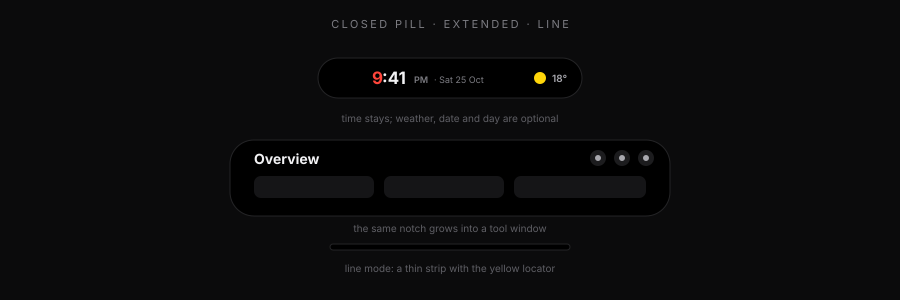
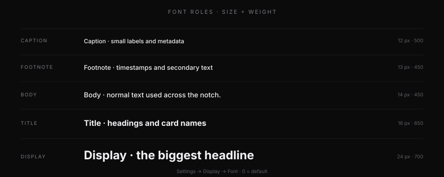
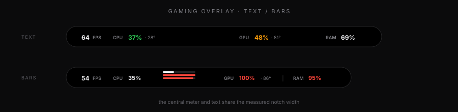

# WinZal — Manual

**Version 1.7.8** · Windows 10 / 11 x64 · by **Bipin Rizal**

The illustrated version is [`manual.html`](manual.html). Open it in a browser for the full design, icons and diagrams.

---

## Quick start

- Hover the notch to wake it.
- Click it to open the active tool.
- Click outside or press `Esc` to close.
- `Ctrl + Alt + Space` opens or closes it from anywhere.
- Triple-click the closed notch to toggle Windows Do Not Disturb.

1. **Closed pill** — time first; media, lyrics, weather or gaming stats when active.
2. **Extended** — header, active tool and the dock.
3. **Line** — a thin strip with an amber locator dot.

### Closed pill text

**Settings → Notch → Closed pill** has the same structure as the pill itself:

- **Text size** — 10–24 px. The whole clock line scales: time, period, date/day and temperature.
- **Weight** — the clock weight slider below.
- The preview above shows the real time, period, date sample and temperature, including the Weather/Date/Day toggles.

The pill widens with larger text and always fits the clock face, date/day and weather items. **Extra width** is optional air: at 0 it auto-fits the measured row plus 12 px per side, and toggling date/day/weather or changing the clock face resizes it immediately.

### Clock faces

WinZal ships five faces: **Stacked**, **Split**, **Scatter**, **Classic** and **Word**.

Pick one in **Settings → Notch → Clock faces**. **Classic** is the default and matches the previous clock. The expanded Overview and the closed pill both use the selected face.

- **Stacked** — hours over minutes in a tall two-line block.
- **Split** - hour and minute separated by a vertical bar, with live seconds and the period at the side. The bar height is adjustable.
- **Scatter** — hour, minute and second sit apart, tied by a thin diagonal line. The expanded Overview updates the seconds live.
- **Classic** — centered time with the date and weather underneath.
- **Word** — the time written out, for example `fourThirtyone`.

All faces follow the clock weight, emphasized hour and first-digit accent. They scale fluidly: the expanded face fills the card, and the closed pill uses a compact version of the same design.

---

## Header icons

| Icon | What it does |
|---|---|
| 👁 **Eye** | **Presentation mode** — hides clipboard previews and the vault while sharing. Auto-enables for Windows Graphics Capture apps (Teams, Snipping Tool) and OBS. |
| 👻 **Ghost** | **Silent mode** — 28% ghost + fully click-through. Triple-click its area, `Ctrl + Alt + S`, or the tray to wake it. |
| 🌙 **Moon** | **Do Not Disturb** — the real Windows DND state. |
| 📌 **Pin** | **Keep open** — stops closing when the pointer leaves. |

Presentation mode and Silent mode are different: presentation protects content; silent makes the notch itself invisible to the mouse.

---

## Tools

Enable, disable and reorder them in **Settings → Tools**.

| Tool | What it does |
|---|---|
| **Overview** | Clock, weather, quick tiles, power mode and system status. |
| **Now Playing** | Artwork, title, artist, seek, transport, output mixer, volume, synced lyrics. |
| **Timer** | Countdown, alarm and a live activity that opens the notch when time is up. |
| **To-Dos** | Fast local checklist. |
| **Notes** | Plain notes, saved instantly on this PC. |
| **Clipboard** | Text, links and images; redacted while presenting. |
| **Shelf** | Drop files for a temporary shelf and drag them back out. |
| **Ask** | Local AI chat (Gemini, Groq or a custom OpenAI-compatible endpoint). |
| **AI Usage** | One custom JSON usage endpoint with a name, paths and a test button. |
| **Weather** | Current, hourly and daily forecast; automatic or fixed location. |
| **Hardware** | CPU, GPU, RAM, temperatures, ping and one minute of history. |
| **Discord** | Voice call, participants, mute states and Rich Presence. |
| **Vault** | Passwords and 2FA codes, encrypted locally. PIN or Windows Hello. |
| **Settings** | The gear at the end of the dock. |

---

## Settings map

| Page | Contains |
|---|---|
| **General** | Startup, language, weather location, updates. |
| **Notch** | Closed pill/line, size, **closed text size and weight**, **clock face**, clock accent, weather/date/day. |
| **Appearance** | Theme, material/glass, corners, accent, island style. |
| **Display** | Visibility, monitor, position, silent, DND, recording dots, **Font**, presentation. |
| **Performance** | Motion intensity, GPU acceleration, iGPU/dGPU, FPS unlock, **Gaming look** and **Gaming mode**. |
| **Music** | Music in the pill, lyrics layout, size, weight, min width, pill length, auto width, height, offset, equalizer, glow, animation. |
| **Tools** | Tool order and visibility; vault settings. |
| **Timer** | Alarm sound, volume, duration. |
| **AI** | Ask provider/model/key; custom AI Usage endpoint. |
| **Discord** | Client ID, secret, Rich Presence. |
| **About** | Version, update check, changelog, author. |

---

## Font — Display → Font

Five roles share one scale. Pick a role, adjust **size** and **weight**, and the whole UI follows.

| Role | Default |
|---|---|
| Caption | 12 px · 500 |
| Footnote | 13 px · 450 |
| Body | 14 px · 450 |
| Title | 16 px · 650 |
| Display | 24 px · 700 |

- **0 = default.** Every slider is an offset, not an absolute value.
- Size range: **−4 → +8 px**, 0.5 px steps. Line height follows.
- Weight range: **−300 → +300**, 50 steps. Inter is variable, so 450 and 650 are real weights.
- **Reset font** sets all five roles back to 0.
- The selected role is previewed with its live size/weight above the sliders.
- The original L4 notch uses 11/12/13/15/22; WinZal is intentionally one step larger and slightly bolder.

## Gaming — Performance → Gaming look

The preview is the real pill: toggles change it immediately.

- **Show:** FPS, CPU, Temperatures, GPU, RAM.
- **Stat style:** Text or Bars. Bars adds a central stacked CPU/GPU/RAM meter; the text values stay at the sides.
- **Divider line:** optional separator between the FPS/CPU group and the GPU/RAM group.
- **Dynamic width:** the pill follows the real row width; the central meter and text grow/shrink together so everything stays inside the notch.
- **Gaming overlay:** on/off; the preview shows **ON/OFF**.
- **Transparent in games:** reuses the existing **Glass 0.62** alpha while a game is in front.
- **Custom power in games:** switches Lenovo to Custom when a chosen game starts and restores the previous power mode when it exits (also heals after a crash).
- Hiding GPU/temperatures also stops the GPU counter polling; only CPU/RAM are read.

---

## Privacy

### Presentation mode
- Hides clipboard previews and the vault.
- Blocks copying redacted clipboard cards.
- Auto-enables for Windows Graphics Capture and OBS.
- Toggle: Overview eye, Settings → Display, `Ctrl + Alt + P`, or tray.
- Discord’s DXGI screen share may not be detected automatically; use the eye.

### Silent mode
- The notch fades to **28%** and becomes click-through.
- Hover and clicks are ignored.
- Wake with three quick clicks over its area, `Ctrl + Alt + S`, or tray → Silent mode.
- Persists across restarts.

---

## Performance

| Setting | What it does |
|---|---|
| **Motion intensity** | 0–100% slider. 0 = off, mid = reduced, 100 = full. Preview animates only on hover. |
| **GPU acceleration** | Off = CPU/software, lowest RAM. On = GPU. Auto/iGPU/dGPU choose the adapter. Restart applies. |
| **FPS unlock** | One-time elevated helper; stays after restarts. Enables FPS, CPU temperature and Lenovo fan modes. |
| **Gaming stats** | Per-stat toggles; hiding GPU/temps skips GPU counters. |

Idle memory is roughly **10 MB UI + 20 MB helper**, plus WebView2 shared processes. The notch trims its working set while closed.

---

## Music & lyrics

- Lyrics come from LRCLIB and are cached per track.
- Transitions: **Word by Word** plus eight effects: **Word fill sweep, Glitch scramble, Liquid fill, Spotlight, Letter bloom, Spark, Orbit and Ambient**. Lines replace in one commit and never overlap. Tracks without synced lyrics show the real media/video title.
- **Lyrics offset:** ±1 s in 0.1 s steps; positive makes lines appear later.
- **Equalizer:** **Bars, Mirror and Ticks**. **Behind glow:** **Wave, Bloom, Bokeh, Leaves and Night sky**. Wave is a moving ocean swell with a translucent fill below the crest; Night sky has a half moon in the pill and a full moon, random stars, galaxies, a shooting star and a UFO in the expanded panel. Both follow the Equalization Accent. The same visualization continues in the expanded Now Playing panel; one Visualization switch controls both views.
- **Output device:** the Now Playing mixer lists Windows playback endpoints. Pick speakers, headphones or Bluetooth and Windows switches its default output immediately.

---

### Lyric pill

Settings → Music → Songtext has a live preview and its own pill controls:

- **Text size** 10–15 px, **weight** 400–900.
- **Min width** 284–640 px. The pill never shrinks below this.
- **Pill length** 284–640 px. With auto width on it is the maximum; with auto width off it is the fixed width.
- **Auto width** is on by default: it grows with the line and shrinks back, but never below the minimum or beyond the length. Turn it off for a fixed width.
- **Width motion:** the pill eases in and out when it grows or shrinks, instead of snapping at the edges.
- **Pill height** 24–44 px.
- Instrumental tracks show **Instrumental**; tracks without synced lyrics show **Music**.
- LRCLIB results are matched by title, artist and closest duration, so the right edit of a song wins.

## Shortcuts

| Keys | Action |
|---|---|
| `Ctrl + Alt + Space` | Open / close the notch |
| `Ctrl + Alt + P` | Toggle Presentation mode |
| `Ctrl + Alt + S` | Toggle Silent mode |
| `Esc` | Close the open notch (with keyboard focus) |
| `1` … `9` | Jump to a dock tool |
| Triple-click | Toggle DND; while silent, wake the notch |

Tray menu: Open, Settings, Do not disturb, Silent mode, Presentation mode, Start with Windows, Quit.

---

## Troubleshooting

| Problem | Fix |
|---|---|
| Notch invisible | Silent mode. Triple-click, `Ctrl + Alt + S`, or tray → Silent mode. |
| Shortcut does nothing | Another app owns the keys. Use the tray or header buttons. |
| FPS shows a lock | Settings → Performance → FPS unlock once. |
| SmartScreen on install | Unsigned build: **More info → Run anyway**. |
| Windows Hello prompt | The notch hides while the secure prompt is open, then returns. |
| Fonts too large/small | Display → Font → **Reset font**. |
| Look changed too much | Appearance and Notch have their own reset buttons. |

---

## Notes

- Local-only app: no account, no telemetry, no background analytics.
- Settings, vault, notes, to-dos and history stay on this PC.
- Built with Tauri + React + Rust; WebView2 for rendering.

**WinZal 1.7.8** — by **Bipin Rizal**.
